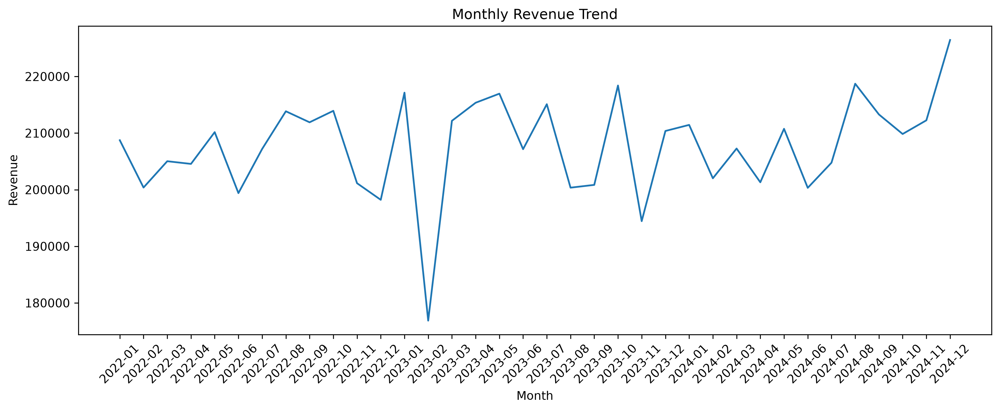
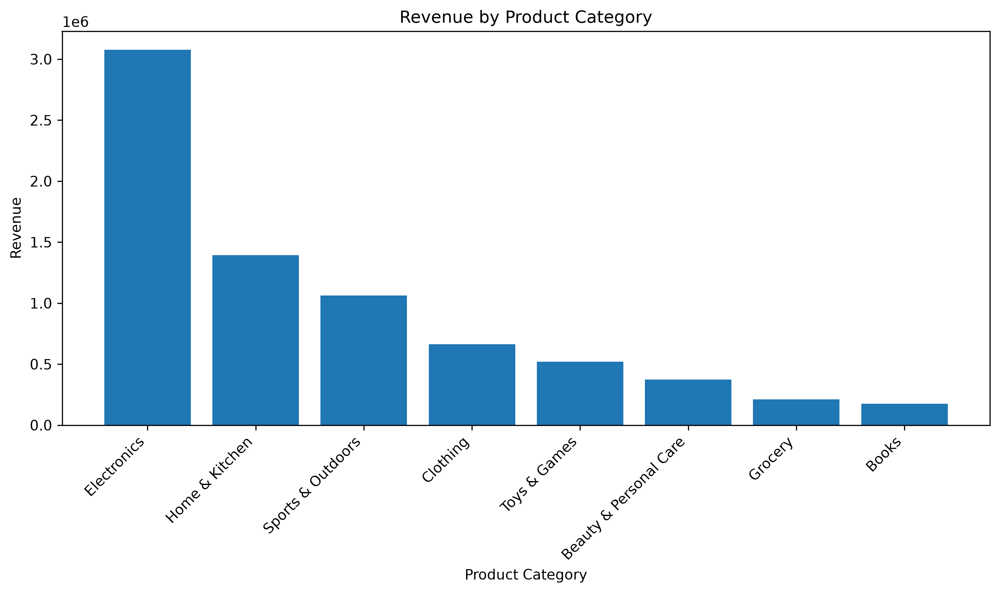
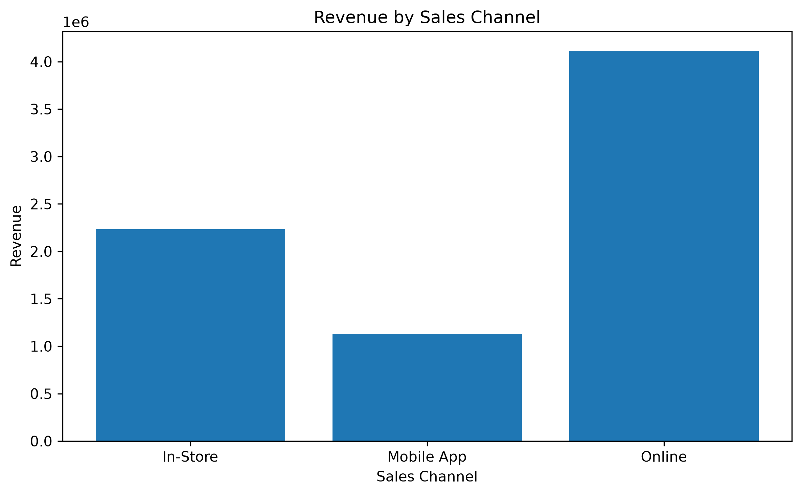
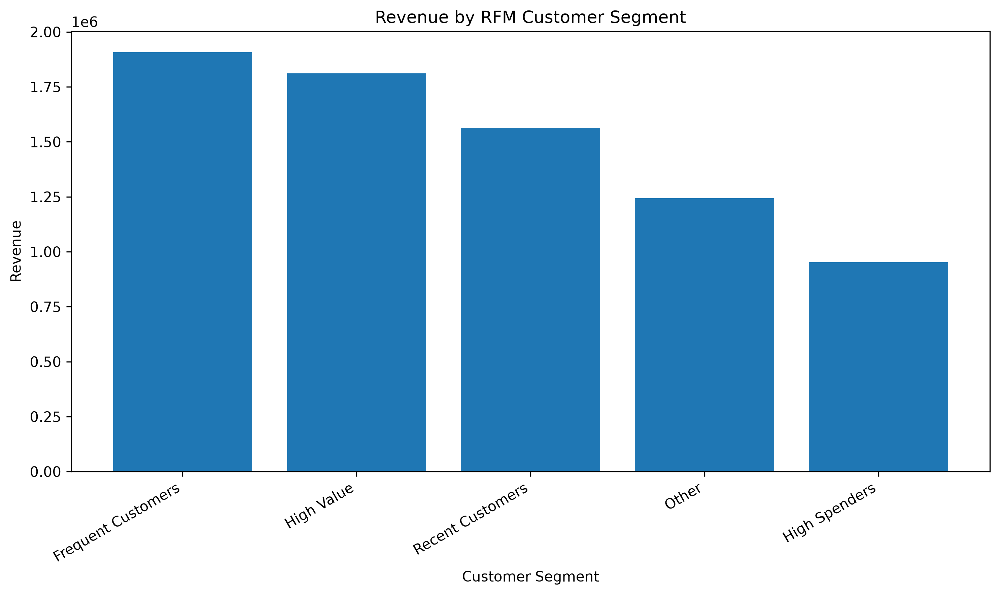
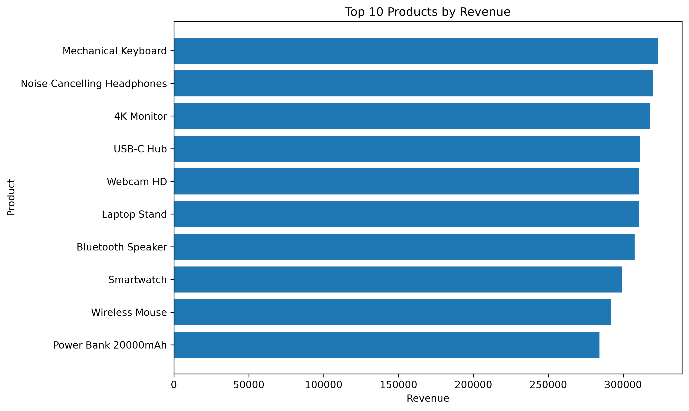
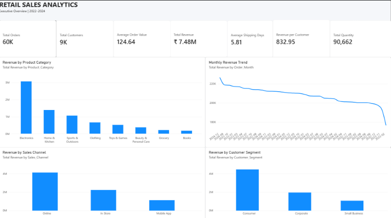
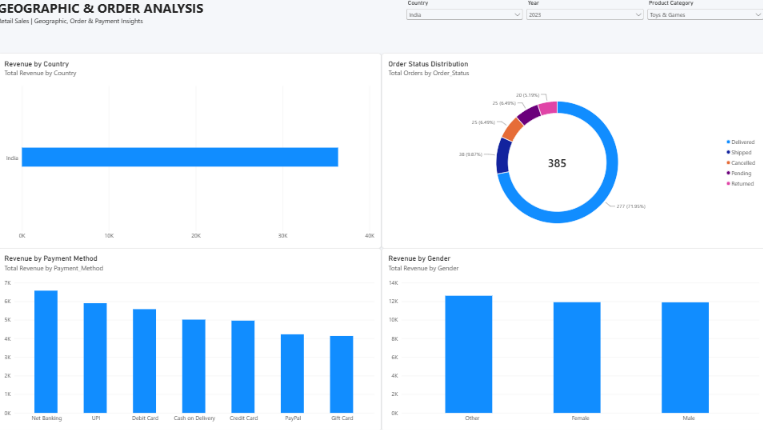
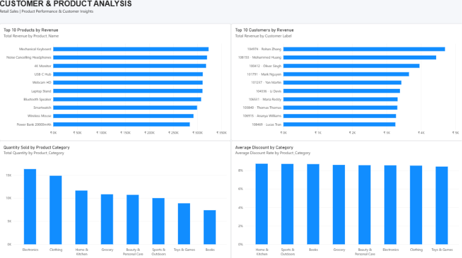

# Retail Sales Analytics: End-to-End Data Analysis Project

An end-to-end analysis of 60,000 sample retail orders from 2022–2024 covering data cleaning in Python, relational modelling and business analysis in MySQL, Excel analysis, and an interactive 3-page Power BI dashboard.

The goal is to answer the questions a retail business actually asks: where does revenue come from, which products and customers matter most, and how do channels, countries and order outcomes compare?

## Business Questions

- How much revenue, how many orders and how many customers does the business have, and what is the average order value?
- Which product categories and individual products drive revenue?
- Which sales channels and countries generate the most revenue?
- Who are the most valuable customers, and how can customers be segmented (RFM)?
- How large is the share of cancelled, returned and negative-quantity transactions?
- How do discounts, payment methods and customer segments compare?


## Tech Stack

| Tool | Used for |
|---|---|
| **Python** (pandas, matplotlib) | Data inspection, cleaning, validation, RFM segmentation, charts |
| **MySQL** | Schema design (3 normalized tables), staging import, 25 business-analysis queries |
| **Excel** | Pivot analysis (category × month revenue matrix) |
| **Power BI** | 3-page interactive dashboard with slicers |

---

## Dataset

| Item | Detail |
|---|---|
| Raw data | 60,900 rows × 20 columns |
| Cleaned data | 60,025 rows × 22 columns (added `Quantity_Type`, `Negative_Quantity_Flag`) |
| Period | 1 Jan 2022 – 31 Dec 2024 |
| Scale | 60,000 orders · 8,978 customers · 80 products · 8 categories · 10 countries |
| Dimensions | 3 sales channels · 5 order statuses · 7 payment methods · 3 customer segments |

**Dataset Source:** AI-generated sample/synthetic retail dataset created with Claude AI for educational and portfolio analysis purposes. The dataset does not represent real transactions from an actual company.

> **Dataset Note:** This project uses an AI-generated synthetic retail dataset created with Claude AI. It is intended for educational and portfolio purposes and does not represent real-world company transactions.

---

## Project Workflow

### 1. Data inspection and cleaning (Python)

Notebook: `Python/01_data_inspection.ipynb`

| Issue found | Treatment |
|---|---|
| 875 duplicate rows | Removed (60,900 → 60,025 rows) |
| Unit prices inflated by exactly 100× (above ₹1,000) | Verified as 100× errors, corrected by ÷ 100 |
| Six different date formats in `Order_Date` / `Ship_Date` | Parsed and standardized to `YYYY-MM-DD` |
| Inconsistent country labels (`United States`, `U.S.A.`) | Standardized to `USA` |
| Missing `Customer_Segment`, `City`, `Payment_Method` | Recovered from the same customer's other records |
| Missing `Age` (4,301 records) | Recovered from the same customer, then Country + City median, then Country + Gender + Segment median; rounded to whole years |
| Missing or invalid `Ship_Date` | Replaced with `Order_Date` + median shipping time |
| Negative quantities (607 rows after cleaning) | Kept and flagged with `Negative_Quantity_Flag` |
| Missing `Email` | Left as NULL, trimmed and lower-cased where present |
| Category / channel text formatting | Trimmed and standardized |

### 2. Database design and SQL analysis (MySQL)

Script: `SQL/SQL_analysis-script.sql`

- Normalized schema: `customers`, `products`, `orders` (primary keys, foreign keys, unique product constraint)
- `retail_staging` table loaded from the cleaned CSV with `LOAD DATA`
- **25 business queries**: total revenue, orders, customers, units, AOV; monthly revenue and order volume; revenue by category, product, segment, channel, country, gender; payment-method usage; order-status mix; negative-quantity analysis; top customers; average discount by category; shipping time by channel; category × channel revenue

Revenue formula used everywhere:

```
Revenue = Quantity × Unit_Price × (1 − Discount_Percent / 100)
```

### 3. Verification and RFM segmentation (Python)

- Key KPIs were recomputed in pandas after the SQL stage as a cross-check.
- Customers were scored 1–5 on **Recency, Frequency and Monetary** value and grouped into five segments:

| Segment | Rule |
|---|---|
| High Value | R, F and M scores all ≥ 4 |
| Recent Customers | R ≥ 4 |
| Frequent Customers | F ≥ 4 |
| High Spenders | M ≥ 4 |
| Other | everything else |

### 4. Excel analysis

`cleaned_data/retail_sales_analysis.xlsx` contains the cleaned data and a pivot table of revenue by product category and month.

### 5. Power BI dashboard

`power_bi/Retail_Sales_Analytics.pbix` has three pages:

| Page | Contents |
|---|---|
| **Executive Overview** | KPI cards (Total Revenue, Orders, Customers, Quantity, AOV, Revenue per Customer, Average Shipping Days), monthly revenue trend, revenue by category, channel and customer segment |
| **Geographic & Order Analysis** | Revenue by country, gender and payment method, order-status donut, slicers for date, country and category |
| **Customer & Product Analysis** | Top products, top customers, quantity by category, average discount rate by category |

---

## Key Metrics

| Metric | Value |
|---|---|
| Total revenue (gross, all order statuses) | **₹7.48M** |
| Total orders | **60,000** |
| Unique customers | **8,978** |
| Units sold | **90,662** |
| Average order value | **₹124.64** |
| Revenue per customer | **₹832.95** |

---

## Key Insights

1. **Electronics dominates.** It generates ₹3.08M, about 41% of revenue. The top three categories (Electronics, Home & Kitchen, Sports & Outdoors) account for roughly 74%.
2. **The top 10 products are all Electronics**, each earning between ₹284K and ₹323K. Revenue is spread across many products rather than depending on a single best-seller.
3. **Online is the leading channel** with 55% of revenue, followed by In-Store (30%) and Mobile App (15%).
4. **Three countries bring in about 61% of revenue:** USA (₹2.08M), India (₹1.42M) and UK (₹1.05M).
5. **Consumers are the largest customer segment** at about 60% of revenue, followed by Corporate (26%) and Small Business (14%).
6. **Revenue remained relatively stable year over year:** ₹2.47M (2022), ₹2.49M (2023), and ₹2.52M (2024), representing approximately 1.8% growth from 2022 to 2024.
7. **Cancelled and returned orders represent about ₹0.96M (12.9%) of gross revenue.** Excluding them, net revenue is about ₹6.5M.
8. **Discounting is uniform.** Average discount sits between 8.4% and 8.7% in every category, so no category is being discounted disproportionately.
9. **RFM:** "High Value" customers are about 14% of the customer base but generate about 24% of revenue.

---

## Charts

| | |
|---|---|
|  |  |
|  |  |
|  | |

### Power BI Dashboard

#### Executive Overview


#### Geographic & Order Analysis


#### Customer & Product Analysis


---

## Repository Structure

```
Retail-Analytics-Project/
├── raw_data/
│   └── retail_sales_raw_dataset.csv
├── cleaned_data/
│   └── retail_sales_clean.csv
│   └── retail_sales_analysis.xlsx
├── Python/
│   └── 01_data_inspection.ipynb
├── sql/
│   └── SQL_analysis-script.sql
├── powerbi/
│   └── Retail_Sales_Analytics.pbix
├── screenshot/
│   └── *.png
└── README.md
```

---

## How to Run

1. **Clean the data:** Open `Python/01_data_inspection.ipynb` and run the notebook. It generates `cleaned_data/retail_sales_clean.csv`.

2. **Load MySQL:** Open `SQL/SQL_analysis-script.sql` in MySQL Workbench. Update the `LOAD DATA LOCAL INFILE` path to your local file location, enable `local_infile` if required, and run the script.

3. **Excel analysis:** Open `cleaned_data/retail_sales_analysis.xlsx` to review the pivot analysis.

4. **Dashboard:** Open `power_bi/Retail_Sales_Analytics.pbix` in Power BI Desktop and refresh the data source if prompted.

Requirements: Python 3.9+, pandas, matplotlib, Jupyter, MySQL 8.x, Power BI Desktop.

---

## Data Notes and Assumptions

- **Revenue is gross:** it includes Delivered, Shipped, Pending, Cancelled and Returned orders. A net-revenue view excluding Cancelled and Returned is listed under future improvements.
- **Negative quantities** (607 rows, most on Delivered orders) are flagged, not deleted, and they reduce revenue by about ₹72K.
- **Imputed fields** (Age, Ship_Date, Payment_Method, City, Customer_Segment) are estimates; analysis involving them should be read as approximate.
- The dataset has no cost data, so **profit and margin analysis are not possible**.

---

## Future Improvements

- Add a **net revenue** measure (excluding Cancelled and Returned) alongside gross revenue in SQL and Power BI
- Add cohort and retention analysis
- Add revenue forecasting
- Investigate return and cancellation drivers by category, channel and country
- Publish the dashboard to Power BI Service and link it here

---

## Author

**VIKASH NAVIK** · [LinkedIn](www.linkedin.com/in/vikas-navik-160b61354) · [GitHub](https://github.com/vikasnavik63)
